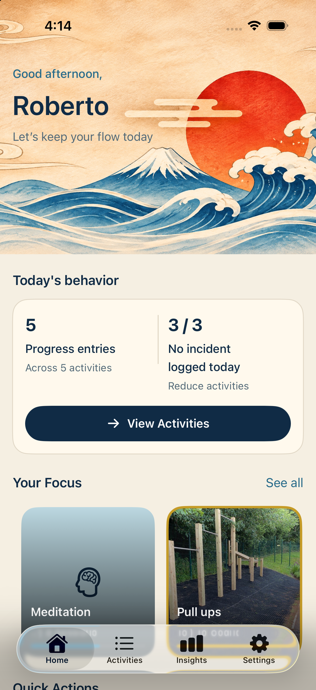
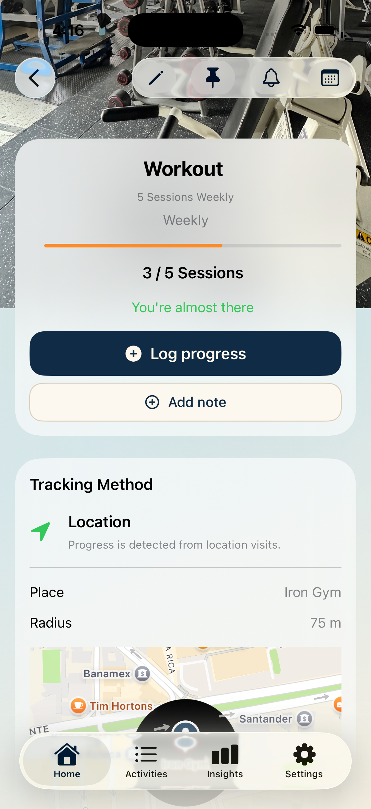
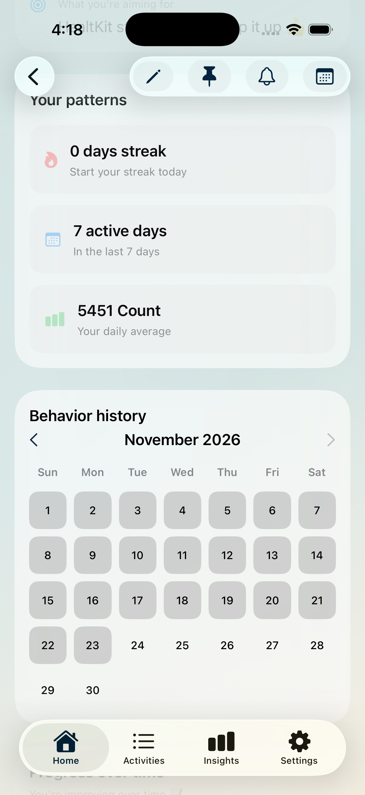
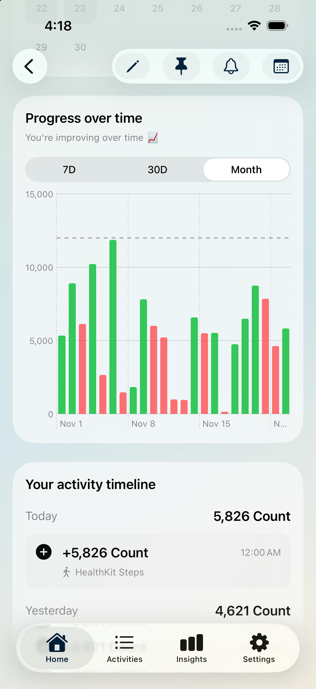
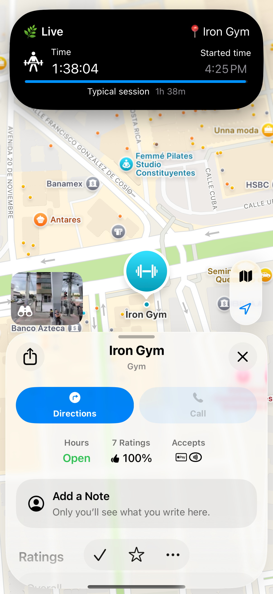
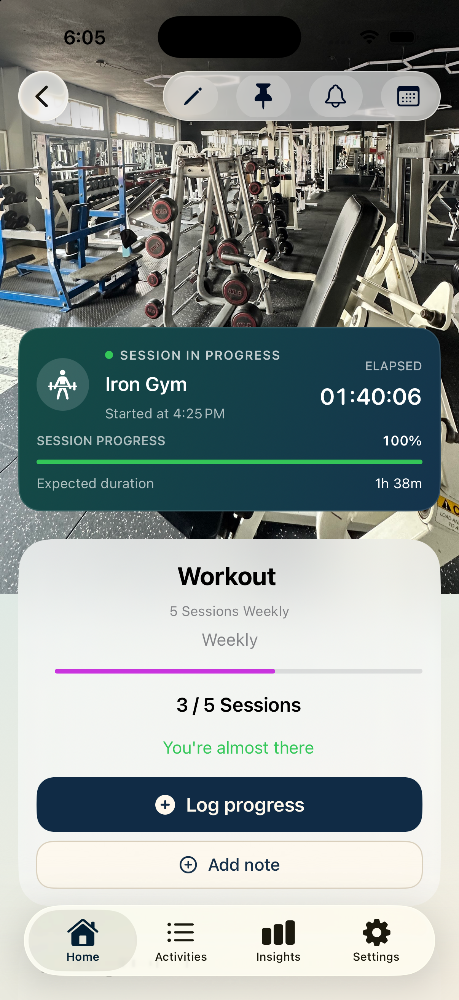
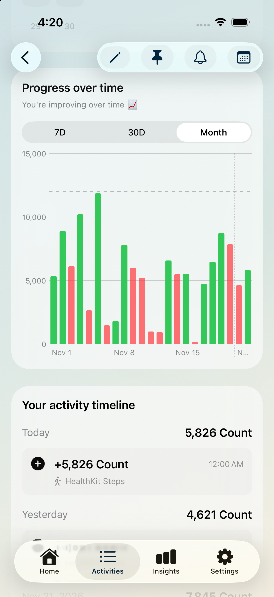

# 🌊 WuFlow

<p align="center">
  
</p>

<p align="center">
  <strong>Build better habits. Find your flow.</strong><br>
  A native iOS application for observing, tracking, and understanding personal behavior.
</p>

<p align="center">
  
  
  
  
</p>

---

## Overview

WuFlow started as a habit tracker and evolved into a broader exploration of personal behavior.

Its guiding idea is:

> **Observe behavior before trying to change it.**

Rather than focusing only on whether a habit was completed, WuFlow brings together five parts of a person's daily experience:

- **Intention** — what someone wants to build, maintain, or reduce.
- **Behavior** — what actually happens.
- **Context** — where and when behavior occurs.
- **Observation** — what someone notices about their own behavior.
- **Insight** — patterns derived from recorded activity.

The goal is to make tracking less dependent on manual input while keeping people in control of their data and how it is interpreted.

## The idea behind WuFlow

WuFlow takes inspiration from the Taoist concept of **Wu Wei (無為)**, often translated as *effortless action*.

The project does not interpret this as eliminating effort. Instead, it explores how technology can reduce unnecessary friction and encourage awareness before intervention.

For example, rather than asking someone to remember to record every gym visit:

```text
Arrive at a saved place
        ↓
Core Location detects the geofence event
        ↓
WuFlow starts an activity session
        ↓
The user receives contextual feedback
        ↓
The session becomes part of their behavioral history
```

The same principle informs integrations with HealthKit, notifications, and Live Activities.

---

## Features

### Activity tracking

Activities represent behaviors someone wants to:

- 🌱 **Build** — increase or develop.
- 🌊 **Maintain** — preserve consistently.
- 🔥 **Reduce** — decrease or move away from.

Activities can include goals, measurement types, progress history, life-area classification, reminders, location automation, and behavioral observations.

### Progress tracking

For Build and Maintain activities, WuFlow records progress over time. Entries can be added manually or synchronized through supported system integrations.

The app provides daily progress, historical records, goal tracking, activity summaries, charts, and active-day visualizations. Progress is stored as structured records rather than being derived from UI state.

### Behavioral observations

WuFlow separates **what happened** from **what someone noticed**.

An observation can include a timestamp, note, optional emotion, optional image, and an observation type. Current observation types include:

- `note`
- `incident`

This allows a behavioral history to contain both everyday reflections and meaningful events.

For example:

```text
Progress
"I went to the gym for 45 minutes."

Observation
"I noticed I had more energy after work today."
```

### Reduce activities

Reduce activities use a different behavioral model. Instead of asking only how much progress was made, WuFlow can help answer:

> How long has it been since the last incident?

Incidents are represented as structured observations. The app can calculate awareness duration, incident count, current and longest incident-free durations, and average intervals between incidents.

### Behavior calendar

The calendar visualizes behavior over time:

- Build and Maintain activities show days containing progress.
- Reduce activities show days containing incidents.

It supports monthly navigation, progress and incident modes, day selection, and detailed inspection of records for a selected day.

### Deterministic insights

WuFlow uses deterministic domain logic for its current behavioral analysis rather than relying on an AI model for basic calculations.

Current insight areas include:

- **Typical session duration** — estimates the typical time spent at a place from recorded sessions.
- **Session consistency** — compares session durations against the median.
- **Life-area attention** — measures how recorded progress is distributed across life areas.
- **Life-area trends** — compares periods to identify changes in activity distribution.

These calculations live outside SwiftUI views and can be tested independently.

### Location automation

WuFlow uses Core Location geofencing to connect physical context with behavior.

Users can create reusable Places, configure geofence radii, associate activities with locations, detect region entry, start activity sessions, and receive contextual notifications.

```text
Enter a saved place
        ↓
Core Location region event
        ↓
LocationAutomationEngine
        ↓
Activity session
        ↓
Live Activity / notification
        ↓
Session tracking
```

The location layer is separated from persistence through dedicated services and automation logic.

### HealthKit integration

WuFlow can use HealthKit data to reduce manual tracking.

Current integrations include daily step data and workout-related data. Synchronized health data can be incorporated into the progress model.

Synchronization is designed to be idempotent. For example, syncing daily steps updates the existing record for that activity and day instead of creating duplicates.

### Notifications and Live Activities

WuFlow uses UserNotifications and ActivityKit to provide contextual feedback without requiring the app to remain open.

Interactive notifications can allow progress to be recorded directly from a notification. Live Activities display real-time session information, including Dynamic Island presentation on compatible devices.

---

## Screenshots

The screenshots below should represent the current UI, not earlier design iterations.

| Screen | Suggested asset |
|---|---|
| Home dashboard | `Screenshots/home-dashboard.png` |
| Activity detail and progress | `Screenshots/activity-detail.png` |
| Behavior calendar | `Screenshots/behavior-calendar.png` |
| Insights | `Screenshots/insights-dashboard.png` |
| Place and geofence session | `Screenshots/geofence-session.png` |
| Live Activity / Dynamic Island | `Screenshots/live-activity.png` |
| HealthKit step tracking | `Screenshots/healthkit-steps.png` |

<p align="center">
  
  &nbsp;&nbsp;
  
</p>

<p align="center">
  
  &nbsp;&nbsp;
  
</p>

<p align="center">
  
  &nbsp;&nbsp;
  
</p>

---

## Architecture

WuFlow separates presentation, domain calculations, persistence, and system integrations.

At a high level:

```text
                         SwiftUI
                            │
                            ▼
                      Application
                            │
              ┌─────────────┴─────────────┐
              ▼                           ▼
         Domain Logic                System Services
              │                           │
              │                    ┌──────┼──────────┐
              │                    ▼      ▼          ▼
              │              CoreLocation HealthKit Notifications
              │
              ▼
         Repositories
              │
              ▼
           SwiftData
```

Behavioral calculations are kept outside the views:

```text
SwiftData records
        ↓
Domain calculators
        ↓
Domain summaries
        ↓
Insights and visualizations
        ↓
SwiftUI
```

This keeps business rules testable and prevents views from becoming responsible for behavioral analysis.

### Domain calculations

Examples of focused domain components include:

```text
ProgressCalculator
DecreaseActivityCalculator
SessionDurationCalculator
SessionConsistencyCalculator
LifeAreaAttentionCalculator
LifeAreaTrendCalculator
BehaviorDayCalculator
BehaviorCalendarCalculator
PeriodCalculator
InsightEngine
```

Each calculator has a focused responsibility and can be tested independently from SwiftUI.

### Persistence

WuFlow uses SwiftData for local persistence.

Core models include:

```text
Activity
 ├── ProgressRecord[]
 ├── ObservationRecord[]
 └── Place

Place
 └── PlaceSession
```

Observations support multiple behavioral meanings through a structured observation type, including notes and incidents.

---

## Engineering highlights

WuFlow is also an exploration of modern native iOS engineering:

- Native SwiftUI application architecture.
- Separation of presentation and domain logic.
- Repository pattern and dependency injection.
- SwiftData persistence and `@ModelActor`.
- Swift Concurrency, actors, and structured concurrency.
- Core Location geofencing and location automation.
- HealthKit synchronization.
- Interactive notifications and Live Activities.
- MapKit-based location selection.
- Deterministic behavioral analysis.
- Reusable SwiftUI components.
- Unit-tested domain logic.

## Testing

Domain logic is covered by unit tests. In-memory SwiftData configurations are used where persistence behavior needs to be exercised.

Tested areas include:

- Progress and decrease-activity calculations.
- Incident intervals.
- Session duration and consistency.
- Life-area attention and trends.
- Behavior-day aggregation and calendar positioning.
- Observation filtering.
- Mixed progress and incident data.

The goal is to keep behavioral rules independent from the UI so they can be validated with deterministic tests.

## Technologies

| Area | Technologies |
|---|---|
| Language | Swift 6 |
| UI | SwiftUI, NavigationStack, Charts, SF Symbols |
| Persistence | SwiftData, `@Model`, `@ModelActor` |
| Apple frameworks | Core Location, MapKit, HealthKit, UserNotifications, ActivityKit, WidgetKit |
| Concurrency | Swift Concurrency, `async/await`, actors, structured concurrency |
| Testing | XCTest, in-memory SwiftData, domain unit tests |

## Project structure

The project is organized by feature and responsibility. The following is a high-level representation:

```text
WuFlow
├── Features
│   ├── Activities
│   ├── Places
│   ├── Statistics
│   └── Settings
├── Components
├── Domain
│   ├── Progress
│   ├── Observations
│   ├── Insights
│   ├── Sessions
│   └── BehaviorCalendar
├── Services
│   ├── LocationService
│   ├── HealthKitSyncService
│   └── NotificationManager
├── Automation
│   ├── LocationAutomationEngine
│   └── NotificationActionHandler
├── Persistence
│   ├── Models
│   └── Repositories
└── Resources
```

## Roadmap

WuFlow is being developed incrementally.

### Implemented

- Activity and progress tracking.
- SwiftData persistence.
- Behavioral observations and incident tracking.
- Reduce activity calculations.
- Behavior calendar.
- Deterministic insights.
- HealthKit integration.
- Location automation and Place sessions.
- Notifications and Live Activities.

### Exploring next

- Behavioral experiments.
- Comparing behavior before and after intentional changes.
- Additional deterministic insights.
- AI-assisted behavioral synthesis.
- Apple Watch integration.
- Widgets and Shortcuts.
- Additional automation sources.
- Cloud synchronization.

AI-assisted interpretation is being considered as a later layer, after structured behavioral data and deterministic rules provide a foundation.

---

## Why WuFlow?

Many habit trackers primarily ask whether something happened.

WuFlow explores a different question:

> **What can we learn when behavior, context, and observation are recorded together?**

The project combines automatic context with explicit user input to create a richer behavioral history, while keeping the underlying system understandable and deterministic.

It is both a personal application and an ongoing exploration of modern iOS engineering.

## Author

**Roberto Abad**  
Senior Software Engineer

- **iOS:** Swift, SwiftUI
- **Full-stack:** .NET, C#

[GitHub](https://github.com/RobertoAbad505) · [LinkedIn](https://www.linkedin.com/in/robertoabad95/) · [Portfolio](https://roberto-abad.web.app)

## License

This project is open for educational and portfolio purposes.
